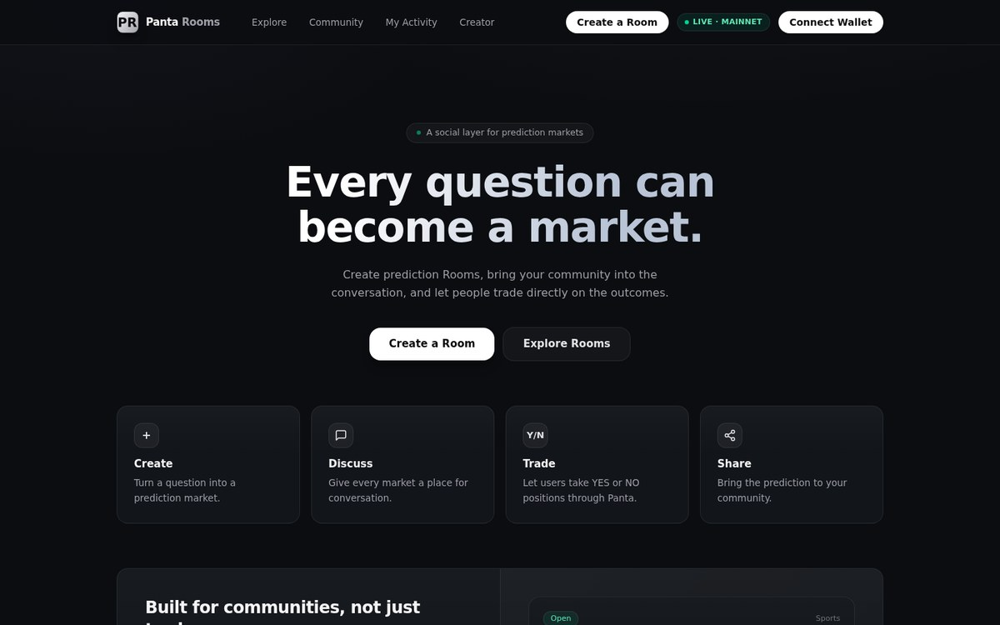

# Panta Rooms

**A social layer for prediction markets — built on the Panta API (Solana).**



**[Live app →](https://panta-rooms.vercel.app)** · Built for [Colosseum's Crypto World's Fair](https://colosseum.com) — the largest hackathon in crypto history (2,973 submissions)

     

> Every question can become a market. Create prediction Rooms, bring your community into
> the conversation, and let people trade directly on the outcomes.

Panta Rooms treats a prediction market not as a destination app, but as a **Room** — a
shareable social space where a Panta market powers the pricing while the community provides
the conversation. Any Panta catalog market can become a Room; any question can become a
market through Panta's documented create flow.

---

## What it does

| Journey | Implementation |
|---|---|
| **Discover** | Live Panta catalog via `GET /markets/` with real category filters (from `GET /categories/`), status filters, cursor pagination and search |
| **Room** | Market panel (spot prices, resolution rule, creator, volume), live trade tape (`GET /markets/{id}/trades/`), discussion with emoji reactions, shareable `#/room/{marketId}` links |
| **Create** | Wizard: natural-language question → AI structuring (never predicts; flags ambiguity) → user review → Panta fee quote (`POST /markets/create/quote/`) → unsigned tx (`POST /markets/create/build/`) → **wallet signs** → broadcast on our RPC → `POST /markets/register/` → Room goes live |
| **Trade** | Documented primary-buy loop: `POST /primaryorderquote/` → `/primaryorderbuild/` (instructions) → client compiles a v0 transaction → **wallet signs** → broadcast → `/primaryordersubmit/` → `/primaryorderverify/` (polled) → attribution via `POST /trades/` |
| **My Activity** | Positions via `GET /positions/?wallet=` with client-side mark-to-market (shares × spot price, per docs), win-claim flow (`POST /claim/build/` → sign → broadcast → report) |
| **Creator** | Markets created via this API account (`createdBy=me`) + rooms created with the connected wallet. No fabricated traction |

## Demo vs Live (honest by design)

- **LIVE** — all data comes from the Panta API with a server-side `pk_live_` key.
- **DEMO** — when Panta is unreachable/unconfigured (or the user has no wallet), the UI
  degrades to deterministic sample data, always labeled **DEMO DATA**. Simulated fills say
  so explicitly; no fabricated signatures, volumes or "confirmations" — ever.

## Architecture

```
Browser (Next.js 16 SPA at /)
  ├── hash-routed views: Landing · Discover · Room · Create · My Activity · Creator
  ├── Solana wallet-adapter (Phantom, Solflare) — signing happens HERE, never server-side
  └── broadcast via NEXT_PUBLIC_SOLANA_RPC
        │
        ▼
/api/panta/[...path]  ← allowlisted proxy; injects X-Api-Key server-side
  src/server/panta/   ← typed service layer split per docs:
     client.ts (auth, errors, retries) · discovery.ts · markets.ts · creation.ts
     trading.ts · positions.ts · claims/attribution · normalize.ts · demo.ts
        │
        ▼
Panta API  https://live-api.panta.market/api/v1   (trailing slashes required)
Solana     unsigned tx/instructions in → wallet-signed tx out → broadcast → verify
SQLite     rooms + comments + reactions only (markets live in Panta)
```

## Verification status (against live Panta, 2026-09-21)

| Capability | Status |
|---|---|
| Market discovery (`/markets/`) | VERIFIED + IMPLEMENTED (live) |
| Market data (`/markets/{id}/`) | VERIFIED + IMPLEMENTED (live) |
| Trade tape (`/markets/{id}/trades/`) | VERIFIED + IMPLEMENTED (live) |
| Categories (`/categories/`) | VERIFIED + IMPLEMENTED (live) |
| Trading quote (`/primaryorderquote/`) | VERIFIED LIVE (real quote returned) |
| Trading build/sign/submit/verify | IMPLEMENTED per docs; signing requires a funded wallet (exercisable by judges with Phantom) |
| Market creation (quote/build/register) | IMPLEMENTED per docs; requires wallet + creation fee |
| Trade attribution (`/trades/`) | IMPLEMENTED (best-effort after confirmed buys) |
| Positions (`/positions/`) | IMPLEMENTED — endpoint intermittently unstable in Panta production; surfaced honestly with retry |
| Win claims / creator fees | IMPLEMENTED per docs; requires eligible positions |
| AI question structuring | IMPLEMENTED (structured proposals only — no predictions, ever) |

## Running

```bash
cp .env.example .env   # add your Panta API key
bun install
bun run db:push
bun run dev
```

Attribution: **Powered by Panta** badge appears in the footer per Panta API Terms of Use.
